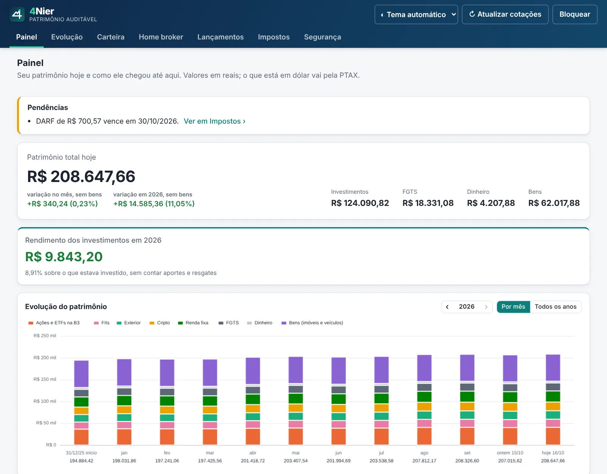

# 4Nier · Patrimônio Auditável

Controle de investimentos B3 + exterior com rentabilidade auditável, 100% local e gratuito.



**[Baixar a versão mais recente](https://github.com/4nier-app/patrimonio/releases/latest)** · para Windows, Mac e Linux · grátis e de código aberto

Os dados ficam só no seu computador, sem nuvem e sem celular, por segurança.

## O que faz

- **Carteira consolidada em reais:** ações, FIIs, Fiagros, FI-Infra, ETFs e BDRs da B3, fundos,
  Tesouro Direto, renda fixa, corretoras do exterior e cripto, com FGTS, conta
  corrente e bens no patrimônio.
- **Rentabilidade pelo tempo real de exposição:** o capital conta a partir da
  data exata da compra e deixa de contar na data exata da venda (Modified Dietz
  diário por mês, encadeado no ano). Comparação com CDI, IPCA, Ibovespa,
  S&P 500 e dólar.
- **Nada é caixa-preta:** cada número pode mostrar a operação, a cotação, o
  câmbio (PTAX), as taxas e a fórmula usada, com os valores substituídos.
- **Ganho de cada compra:** na página do ativo e na Evolução (na setinha ▸ de
  cada ativo), cada compra que ainda está na carteira mostra o custo com
  taxas, o valor e o ganho desde a compra (nas vendas, as compras mais antigas
  saem primeiro). É informativo: o imposto usa o preço médio, como manda a
  Receita.
- **Dólar como chegaria no Brasil:** informe o custo da sua corretora no
  exterior para trazer o dinheiro (na Nomad, conversão de 1% + IOF de 0,38%)
  e o saldo dela aparece pelo valor de resgate: dólar comercial menos as
  taxas. As compras também entram pelo valor de resgate do dia, então o ganho
  é o que você teria a mais em reais depois de trazer o dinheiro. Sem o custo,
  vale a PTAX. Os impostos sempre usam a PTAX, como manda
  a Lei 14.754/2023.
- **Alocação ideal:** defina a meta de cada classe (ações, FIIs, exterior,
  cripto, renda fixa, dinheiro…) e veja quanto falta em cada uma e onde pôr o
  próximo aporte, sem precisar vender nada.
- **Meta de patrimônio:** diga quanto quer ter e até quando; o Painel mostra
  quanto falta, quanto crescer por mês e, no ritmo dos últimos 12 meses,
  quando você chega lá.
- **Projeção de proventos:** quanto você deve receber nos próximos 12 meses,
  mês a mês e por ativo, pelo que cada ação, FII e ETF pagou por cota nos
  últimos 12 meses e pelas cotas que você tem hoje (EUA já sem os 30%
  retidos). O app também lista os proventos que faltam lançar, pelo
  histórico dos ativos que você teve, para lançar com um clique.
- **Imposto de renda:** apuração mensal da B3 (isenção de R$ 20 mil, day trade,
  FIIs, prejuízo a compensar) com aviso de DARF; ganho anual no exterior e em
  cripto pela Lei 14.754; posições em 31/12 para Bens e Direitos.
- **Menos digitação:** importa os extratos da B3 (todas as corretoras de uma
  vez): o de negociação traz as compras e vendas, e o de movimentação traz os
  dividendos, JCP e rendimentos, as bonificações e os desdobramentos. Lê também
  notas em PDF no padrão SINACOR e confirmações da Nomad, ou uma planilha CSV. Cotações, PTAX, cotas de fundos (CVM) e preços do
  Tesouro são buscados automaticamente.
- **Seus dados ficam com você:** tudo roda localmente, num banco criptografado
  pela sua senha. Nenhum servidor, nenhuma conta, nenhum custo. O app faz um
  backup automático por semana e lembra você de salvar uma cópia fora do
  computador.
- **Começo rápido:** num perfil novo, informe o que você tem hoje em cada
  corretora (quantidade e preço médio) e a carteira fica pronta, sem precisar
  de todo o histórico.
- **Visão simples ou completa:** a visão simples mostra em letras grandes
  quanto você tem, quanto rendeu no ano e se ganhou do CDI, e uma carteira com
  poucas colunas. A completa tem todas as abas, com a evolução mês a mês e a
  rentabilidade detalhada. Troque quando quiser, no topo do app.

## Instalação

Baixe o arquivo do seu sistema na página
[Releases](https://github.com/4nier-app/patrimonio/releases/latest).
O aplicativo ainda não tem assinatura digital paga, então o sistema avisa na
primeira vez:

- **Windows 10/11 (64 bits):** arquivo `-setup.exe`. Em "O Windows protegeu o
  computador", clique em **Mais informações → Executar assim mesmo**.
- **Mac (Intel e Apple Silicon):** arquivo `.dmg`. Arraste para Aplicativos e,
  na primeira vez, clique com o botão direito no app → **Abrir**.
- **Linux:** `.deb` (Ubuntu, Debian) ou `.AppImage` (marque como executável).

Encontrou um erro? [Reporte aqui](https://github.com/4nier-app/patrimonio/issues/new?template=problema.yml),
sempre com valores fictícios.

## Como funciona

| Parte | Tecnologia |
|---|---|
| Aplicativo desktop | [Tauri 2](https://tauri.app) |
| Cálculos e banco | Rust, com aritmética decimal exata |
| Interface | React + TypeScript |
| Armazenamento | SQLite criptografado (SQLCipher, AES-256), chave Argon2id |
| Auditoria | Log de eventos somente-inclusão com cadeia de hash SHA-256 |

Arquitetura completa, fórmulas e roteiro: [docs/ARQUITETURA.md](docs/ARQUITETURA.md).

## Desenvolvimento

Pré-requisitos: [Rust](https://rustup.rs), Node.js 22 e os
[pré-requisitos do Tauri](https://tauri.app/start/prerequisites/) do seu sistema.

```bash
npm install
npm run tauri dev        # abre o app em modo de desenvolvimento
cargo test --workspace   # testes do núcleo
npm test                 # testes da interface
npm run tauri build      # gera o instalador
```

Estrutura:

```
crates/core      regras de cálculo (taxas, rentabilidade, impostos)
crates/ledger    log de eventos com cadeia de hash
crates/storage   cofre criptografado, migrações, histórico do sistema
crates/providers cotações, PTAX, índices, fundos (CVM) e Tesouro
src-tauri        ponte entre o núcleo e a interface
src              interface React
```

## Privacidade e LGPD

O aplicativo não coleta nenhum dado de quem usa. Não há cadastro, servidor,
anúncio nem rastreador: tudo fica num banco criptografado no seu computador,
protegido pela sua senha. Cada pessoa guarda os próprios dados para uso
pessoal, e o autor do projeto não recebe dado de ninguém.

**O que o aplicativo acessa na internet:** só dados públicos de mercado, para
cotações e índices: B3, Banco Central (PTAX e índices), CVM (cotas de fundos),
Tesouro Transparente, Yahoo Finance, Coinbase e Nasdaq Trader. Os pedidos levam
apenas códigos de ativos, CNPJ de fundos e datas, nunca nome, CPF, quantidades
ou valores. Esses sites veem só o endereço de internet do computador, como em
qualquer acesso. Ao abrir, o aplicativo também pergunta ao GitHub qual é a
versão mais recente, para avisar se há atualização (dá para desligar em
Segurança). A chave de recuperação vai pelo seu próprio programa de e-mail; o
aplicativo não envia nada.

**Como apagar seus dados:**
- No aplicativo: Segurança › "Apagar perfil e todos os dados" (pede a senha).
- No Windows, ao desinstalar: marque "Apagar também meus dados".
- No Mac e no Linux, apague a pasta do aplicativo:
  `~/Library/Application Support/io.github.marcelofournier.carteiraauditavel`
  (Mac) ou `~/.local/share/io.github.marcelofournier.carteiraauditavel` (Linux).

A página do projeto fica no GitHub Pages, que registra acessos conforme a
[política de privacidade do GitHub](https://docs.github.com/pt/site-policy/privacy-policies/github-general-privacy-statement).
Relatos de problema no GitHub são públicos: nunca anexe dados pessoais.

Notas de corretagem e extratos reais **nunca** entram neste repositório, nem
anonimizados. As telas em `docs/img/` usam dados fictícios. Os testes usam apenas notas fictícias em `fixtures/sinteticas/`,
e o CI recusa qualquer PDF ou planilha fora dessa pasta.

## Aviso

Este software é uma ferramenta de apoio. Os valores de imposto são uma
estimativa, calculada a partir dos lançamentos que você digitou e da
legislação como o autor a entende. Podem ter erros ou não considerar a sua
situação, e não são orientação fiscal nem contábil. Antes de pagar um DARF ou
entregar a declaração, confira com um contador. O uso das informações é de
responsabilidade de quem usa o aplicativo. Não há garantia de nenhum tipo
(veja a licença).

## Licença

[GPL-3.0-or-later](LICENSE). Você pode usar, estudar, modificar e redistribuir;
versões modificadas distribuídas também devem ser abertas sob a GPL.
